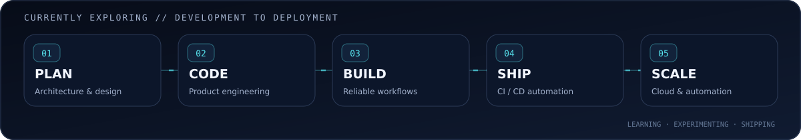

<!-- GitHub-safe profile README: images + Markdown + limited HTML, no page CSS or JavaScript. -->
<div align="center">

<picture>
  <source media="(prefers-color-scheme: dark)" srcset="assets/hero-dark.svg" />
  <source media="(prefers-color-scheme: light)" srcset="assets/hero-light.svg" />
  
</picture>

<a href="https://github.com/sahanRanasingha">
  
</a>

<a href="https://github.com/sahanRanasingha?tab=followers"></a>
<a href="https://github.com/sahanRanasingha"></a>
<a href="mailto:sahanranasingha1@gmail.com"></a>

</div>

---

### `01` / The human behind the commits

> I like turning **“what if?” into “it works.”** I build useful applications, thoughtful interfaces, and reliable backends — and I’m exploring the engineering that takes software from **code to cloud**.

- 💼 **Associate Software Engineer** at **Artslab Creatives**
- 🎓 **B.Sc. in Computer Science & Technology** — Sabaragamuwa University of Sri Lanka
- ⚙️ Building **full-stack applications**, **REST APIs** and practical software solutions
- ☁️ Focused on learning and improving in **Cloud, DevOps, CI/CD and deployment automation**
- 🌍 Based in **Sri Lanka** · nickname **sANaa**

```javascript
const sahan = {
  role: "Associate Software Engineer",
  builds: ["Web apps", "REST APIs", "Useful software"],
  exploring: ["Cloud", "DevOps", "CI/CD", "Automation"],
  philosophy: "Build → Learn → Iterate → Ship",
  status: "Always improving",
};
```

### `02` / Tools of the trade

<div align="center">

**Frontend & UI**


**Backend & Databases**


**Languages & Development Tools**


**Currently growing into**


</div>

### `03` / Where I'm heading

<picture>
  <source media="(prefers-color-scheme: dark)" srcset="assets/pipeline-dark.svg" />
  <source media="(prefers-color-scheme: light)" srcset="assets/pipeline-light.svg" />
  
</picture>

<sub>Learning focus: delivery workflows, infrastructure basics, CI/CD, and making software more dependable after deployment.</sub>

### `04` / GitHub in motion

<div align="center">


<br />


<br />


<sub>Live statistics are provided by third-party services and can occasionally be unavailable or cached.</sub>

</div>

### `05` / Commit. Grow. Repeat. 🐍

<div align="center">

<!-- Generated by the included GitHub Actions workflow after first successful run. -->
<picture>
  <source media="(prefers-color-scheme: dark)" srcset="https://raw.githubusercontent.com/sahanRanasingha/sahanRanasingha/output/github-snake-dark.svg" />
  <source media="(prefers-color-scheme: light)" srcset="https://raw.githubusercontent.com/sahanRanasingha/sahanRanasingha/output/github-snake.svg" />
  
</picture>

<sub>This animation appears after running the included <code>Generate Snake</code> GitHub Action successfully.</sub>

</div>

### `06` / Let's connect

<div align="center">

<a href="https://www.linkedin.com/in/sahanranasingha/"></a>
<a href="mailto:sahanranasingha1@gmail.com"></a>
<a href="https://www.facebook.com/sahanRanasingha"></a>
<a href="https://www.instagram.com/sahan.ranasingha/"></a>

**Have a project idea or an interesting engineering problem?**

<a href="mailto:sahanranasingha1@gmail.com?subject=Hello%20Sahan"></a>

<details>
<summary>☕ Support the experiments</summary>
<br />
<a href="https://www.buymeacoffee.com/rsahan"></a>
</details>

<br />

<sub>Design with intention. Code with curiosity. Keep shipping. 🚀</sub>

</div>
